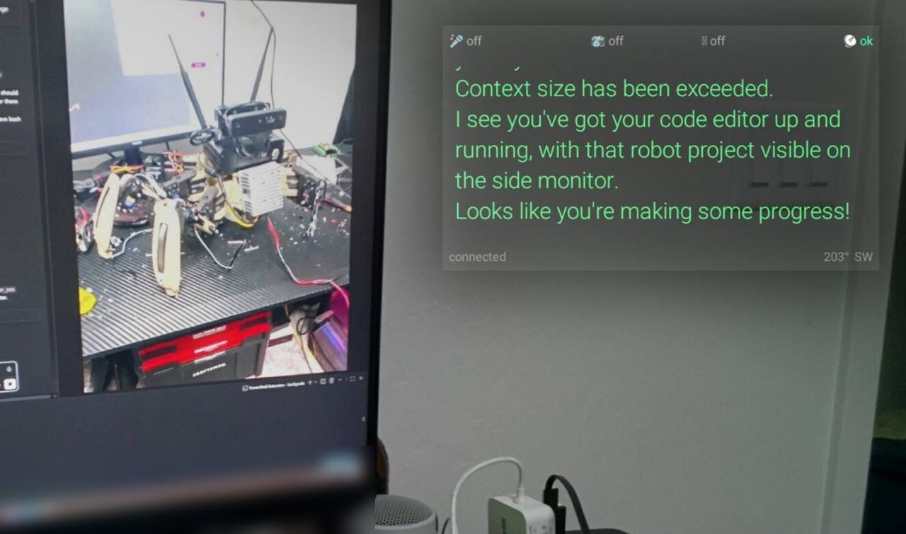
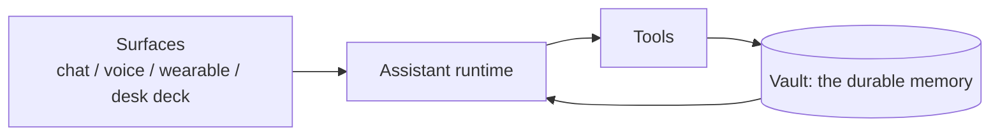

# ARI

**A personal AI whose memory is mine: the models are interpreters, the vault is the assistant.**

*This is ARI: the vault of notes and links the assistant thinks with. Models plug into it; extensions like a wearable display and a robot plug into it too.*

ARI is a single-user personal assistant built around one idea: the durable part of an AI assistant should be owned by the person, not by whichever model happens to be running today. Models come and go; the memory, the rules and the track record stay.

## What it does

- **One assistant, many extensions.** Chat and voice day to day; extensions such as a wearable display, a desk deck and a [hexapod robot](https://github.com/evilhobo1911/hexapod-rl) all connect to the same assistant and memory.
- **Memory with provenance and human approval.** Nothing becomes a lasting fact without a recorded source and a human sign-off. Ambiguous items are blocked, not guessed.
- **Coding agents that can't claim "done" without passing checks.** Completion is judged against defined acceptance checks, not the agent's own report.
- **Runtime-portable.** The same assistant has run on several different model engines.

*Extension: the wearable display. The assistant looks through the camera and comments on the scene (an earlier robot build is on the monitor).*

## Results

As of 2026-10-21:

| Area | Result |
|---|---|
| Coding agents | 610 jobs run. Of 255 with a recorded verdict: 65% pass, 18% pass with scope violation, 17% fail |
| Memory | 330 proposals: 259 applied, 13 rejected, 41 pending, 17 ambiguous blocked rather than guessed |
| Knowledge base | 563 notes |
| Activity | ~2,000 agent sessions and 9.5k tool calls over 90 days |
| Uptime | Gateway up 9.5 days with 0 restarts |

The coding-agent verdict split is the point: the system reports failures and scope violations honestly rather than rounding everything up to success.

## Overview

## Demo video

Coming soon.

## Status and honest scope

ARI is a single-user personal system, not a product. Some components are dormant or stopped, and the numbers above come from one person's real usage, not a benchmark.

## Open-source companion

[obsidian-agent-runtime](https://github.com/evilhobo1911/obsidian-agent-runtime) is the open, generic memory layer.

## Credits

Built on and with: Hermes Agent, Claude Code, Codex, Chatterbox, and Obsidian.

Source is private.

## How this was built
AI is used here as a tool to speed up implementation. I design the system and
define what "working" means. When issues are found, they're identified, and
ARI — my own agent system — fixes them against those checks.
