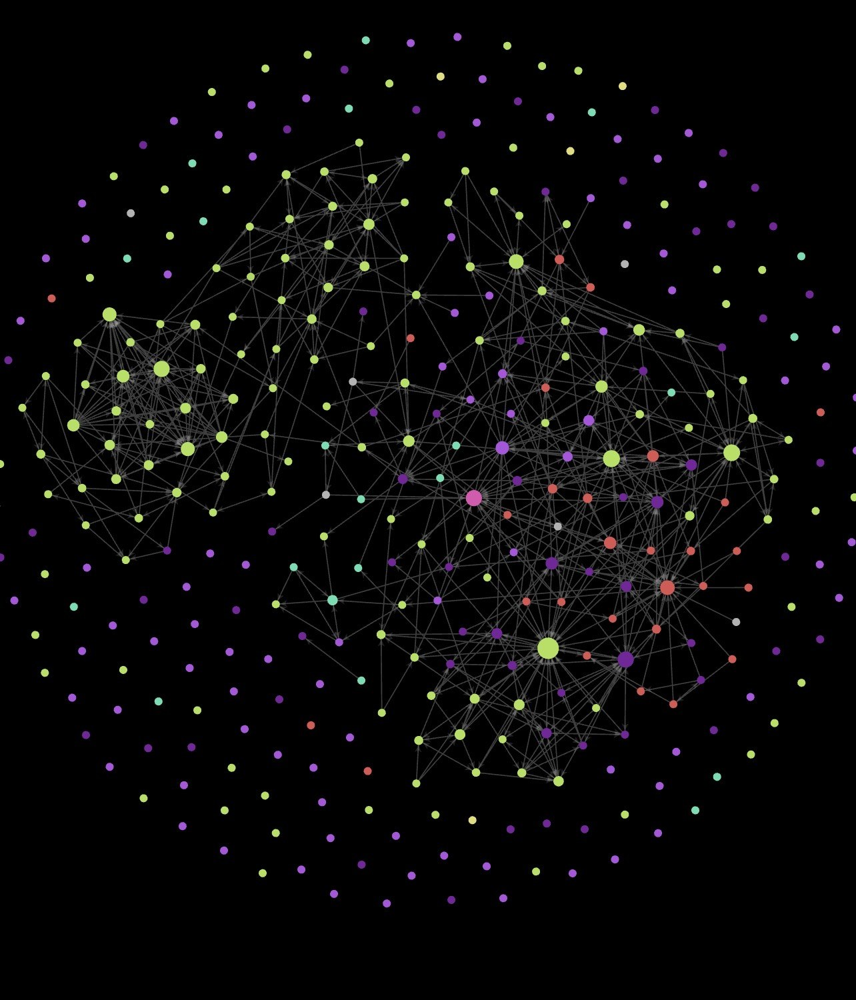
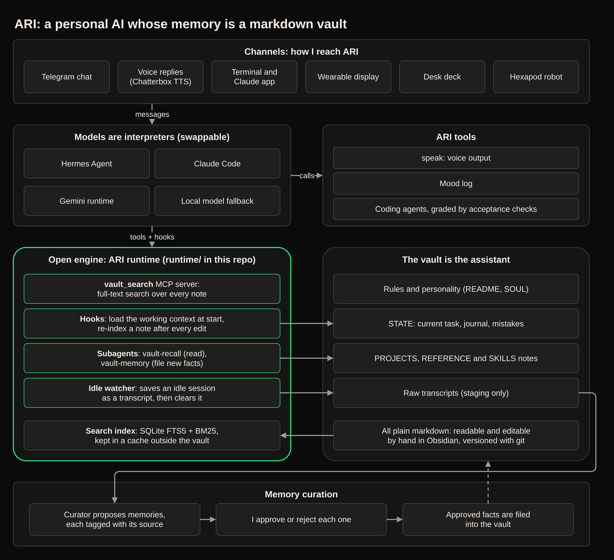
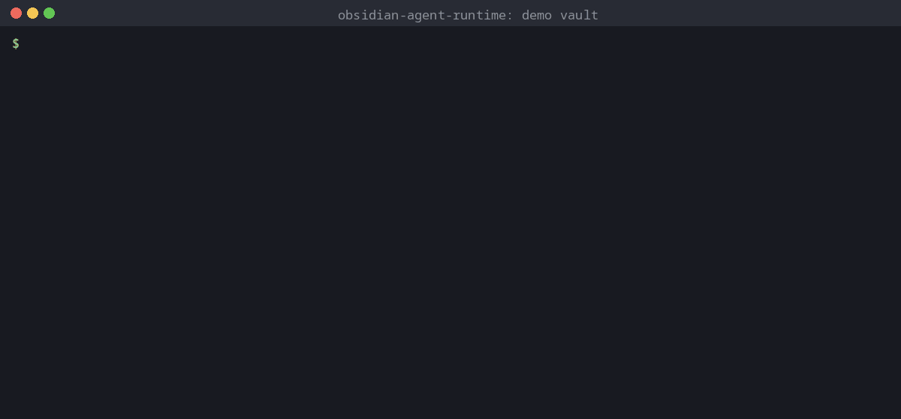

# ARI

**My personal AI assistant, built so that its memory belongs to me and not to any one AI model.**

*Each dot is a note ARI keeps and each line is a link between notes. This is ARI's memory: a folder of plain text files that I own.*

**What it is.** Most chatbots forget you when the chat ends, and whatever they do remember is locked inside one company's product. ARI keeps everything it knows (projects, decisions, preferences, procedures) in a folder of ordinary notes, opened in the free note-taking app Obsidian.

**What it does.** I talk to it by chat or voice. It looks things up in its notes, files away new facts once I approve them, and hands coding jobs to AI agents whose work is checked against defined tests.

**Why it matters.** The AI model is just the interpreter; the notes are the assistant. Models can be swapped without losing anything, and every memory stays readable, editable and owned by a person.

## Highlights

- **One assistant, many extensions.** Chat and voice day to day. A wearable display, a desk deck and a [hexapod robot](https://github.com/tardigraderesearch/hexapod-rl) all connect to the same assistant and memory.
- **Memory with provenance and human approval.** Memories captured from conversations record where they came from and need my sign-off before they are filed. Ambiguous items are blocked, not guessed.
- **Coding agents measured against acceptance checks.** Each job is judged against defined checks, not the agent's own report, and every verdict is recorded as a pass, a pass with a scope violation, or a failure.
- **Model-agnostic.** Hermes Agent, Claude Code and a Gemini-based runtime have each run as ARI, independently, on the same vault.

## Results

As of 2026-10-21:

| Area | Result |
|---|---|
| Coding agents | 610 jobs run; of the 255 with a recorded verdict: 65% pass, 18% pass with scope violation, 17% fail |
| Memory | 330 proposals: 259 applied, 13 rejected, 41 pending, 17 ambiguous ones blocked rather than guessed |
| Knowledge base | 563 notes |
| Activity | ~2,000 agent sessions and 9.5k tool calls over 90 days |
| Uptime | 9.5 days without a restart at the snapshot |

## Architecture

*Source: [media/ari-architecture.drawio](media/ari-architecture.drawio) (opens in [draw.io](https://app.diagrams.net)).*

## The open engine: obsidian-agent-runtime

The green block in the diagram is open source (MIT): **[obsidian-agent-runtime](https://github.com/tardigraderesearch/obsidian-agent-runtime)**. It turns any folder of markdown notes into persistent, searchable memory for [Claude Code](https://docs.claude.com/en/docs/claude-code). Install steps and a five-minute quickstart with a fictional demo vault live in that repo.

*Real output from the engine's command line on its bundled demo vault: index once, then each search returns the matching section of the right note.*

| Piece | What it does |
|---|---|
| **`vault_search` MCP server** | Full-text index of the vault (SQLite FTS5, BM25 ranking), one chunk per `##` section, reindexed incrementally. Exposes `vault_search` and `vault_reindex` to the model over stdio. |
| **`CLAUDE.md` adapter** | A thin runtime adapter that `@`-imports the vault's own `README.md` (the canonical rules) and adds only runtime-specific facts. |
| **SessionStart hook** | Loads the saved working context at startup, resume, `/clear` and after compaction. |
| **PostToolUse hook** | Re-indexes a note as soon as the agent writes or edits it. Changes made elsewhere (Obsidian, git, the shell) are picked up before the next search once the refresh interval passes (default 60 s). |
| **`vault-recall` / `vault-memory` subagents** | Memory reads and writes run in subagents, so search results and filing work stay out of the main conversation. |
| **Idle watcher** | When a long-running session goes idle (default 180 min), saves the new part of the conversation to `STATE/transcripts/`, runs an optional `on_park` command on it (ARI uses this to launch its memory curator), then `/clear`s the session so the next one starts fresh with the working context re-injected. |

### How search works

- **Chunking:** one chunk per `##` section (the preamble keeps the `#` title); sections over 8 KB are split on `###`, then on paragraphs. Hits point at the section, not just the file.
- **Weighted columns:** `title` (5), `heading` (3), wikilink targets (2), frontmatter tags (2), `body` (1), with Porter stemming.
- **Queries:** plain words are ANDed; if nothing matches, search falls back to OR and says so. Phrases, `prefix*` and AND/OR/NOT/NEAR pass through.
- **Note types:** a `type:` frontmatter key wins; otherwise `SKILLS/` notes are procedural, journal notes episodic and the rest semantic, and searches can filter by type.
- **Incremental:** unchanged files (same mtime and size) are skipped unread, touched-but-identical files are caught by hash, and deleted files are pruned.
- **Kept out of the index:** `.obsidian/`, `.git/`, `.claude/`, any `credentials/` folder, dotfiles, sync-conflict copies and raw `STATE/transcripts/` (staging data, not memory).
- **Kept out of the vault:** the index lives in `~/.cache`, one database per vault, so Obsidian sync and git never see a binary file.
- **Small on purpose:** two dependencies (MCP and YAML), no embeddings, no background daemon, and no network requests of its own.

## Credits

Built on and with Hermes Agent, Claude Code, Codex, Chatterbox and Obsidian.

The engine above is open source. ARI's own vault, approval pipeline and coding-agent harness are private.
